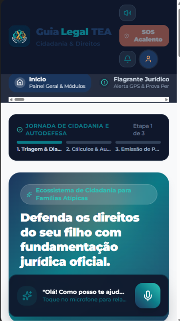

<div align="center">

# MarcioSud — Portfólio Profissional

**Portfólio pessoal de Márcio Antonio Silva**  
Estudante de Análise e Desenvolvimento de Sistemas • Gestão • UX/UI • Desenvolvimento Web

[](https://mas98765.github.io/portfolio)
[](https://developer.mozilla.org/docs/Web/HTML)
[](https://developer.mozilla.org/docs/Web/CSS)
[](https://developer.mozilla.org/docs/Web/JavaScript)
[](./LICENSE)

<a href="https://mas98765.github.io/portfolio">
  
</a>

**[🌐 Visitar portfólio](https://mas98765.github.io/portfolio)** · **[💼 LinkedIn](https://www.linkedin.com/in/marcio-antonio-a2a935149)** · **[💬 WhatsApp](https://wa.me/5561985558270)**

</div>

---

## 👋 Sobre

Portfólio profissional desenvolvido para apresentar minha trajetória em tecnologia, experiência em gestão e projetos acadêmicos.

Sou estudante de **Análise e Desenvolvimento de Sistemas** no Centro Universitário do Distrito Federal (UDF), com experiência em gestão comercial, vendas, arte-finalização e liderança. Meu objetivo é unir visão de negócios, design e tecnologia para criar soluções digitais úteis e acessíveis.

## ✨ Destaques

- Interface responsiva e pensada para diferentes dispositivos
- Navegação fixa com indicação da seção ativa
- Linha do tempo profissional interativa
- Animações suaves com suporte a movimento reduzido
- Lightbox para ampliar imagens dos projetos
- Modal de demonstração em vídeo
- Contato direto pelo WhatsApp
- Estrutura acessível com controles por teclado

## 🛠️ Tecnologias

| Front-end | Recursos | Publicação |
|:---:|:---:|:---:|
| HTML5 | Font Awesome | GitHub Pages |
| CSS3 | Intersection Observer | Responsivo |
| JavaScript puro | Lightbox e modal | Sem dependências |

## 🚀 Projeto em destaque

### GuiaLegal TEA

Plataforma voltada à acessibilidade e inclusão de pessoas com Transtorno do Espectro Autista (TEA), com recursos relacionados à orientação jurídica e cidadania.

- Aplicação Web Progressiva (PWA)
- HTML5, CSS3 e JavaScript
- UI/UX e prototipagem
- Projeto acadêmico desenvolvido na UDF

<p>
  <a href="https://guialegal-tea.onrender.com">
    
  </a>
</p>

## 📁 Estrutura

```text
portfolio/
├── css/
│   └── style.css
├── img/
│   ├── perfil.jpg
│   ├── guialegal-home.png
│   └── guialegal-login.png
├── js/
│   └── script.js
├── video/
├── index.html
├── README.md
├── LICENSE
└── .gitignore
```

## 💻 Executar localmente

O projeto não possui dependências ou etapa de build.

```bash
git clone https://github.com/Mas98765/portfolio.git
cd portfolio
python -m http.server 8000
```

Acesse `http://localhost:8000` no navegador.

## 🌍 Implantação

O site é publicado pelo **GitHub Pages** a partir da branch `main`.

## 🤝 Contato

<div>

[](https://www.linkedin.com/in/marcio-antonio-a2a935149)
[](https://github.com/Mas98765)
[](https://wa.me/5561985558270)

</div>

## 📄 Licença

Distribuído sob a licença MIT. Consulte o arquivo [`LICENSE`](./LICENSE).

---

<div align="center">

Feito com dedicação por **Márcio Antonio Silva**

</div>
